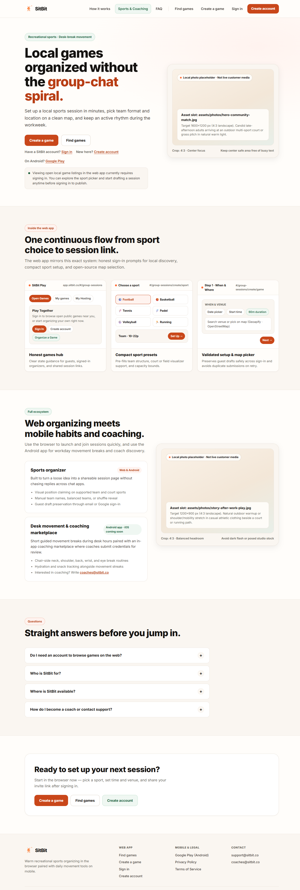
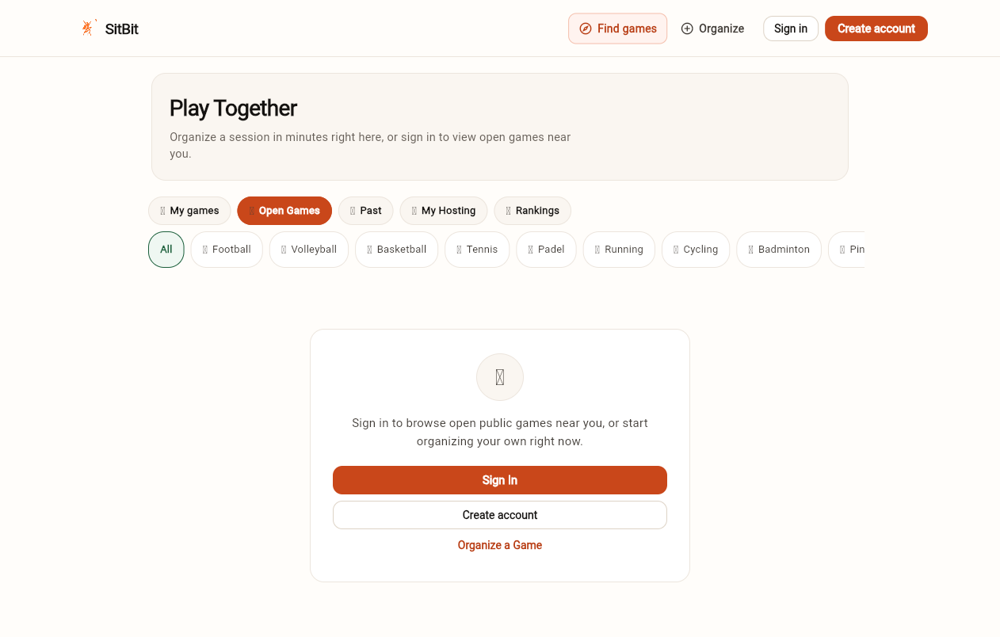
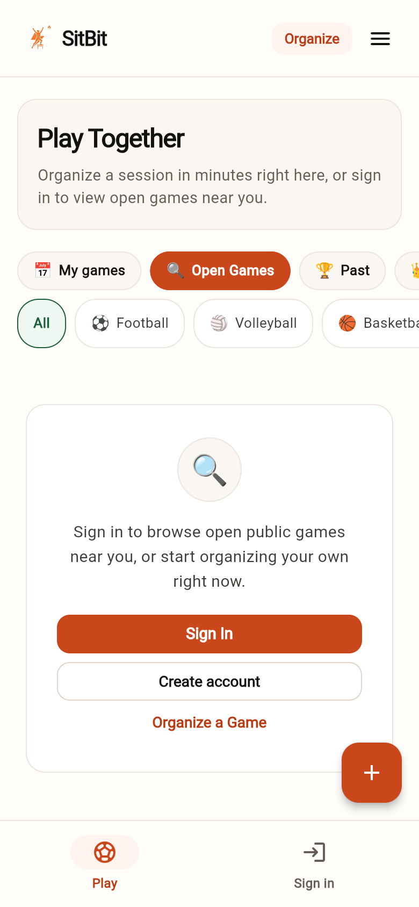
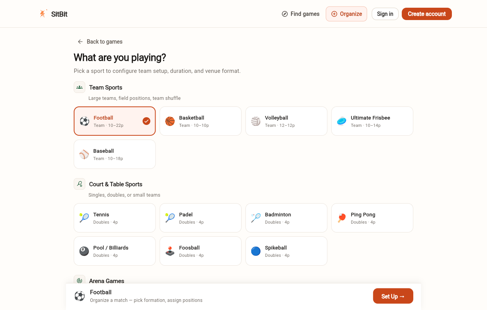
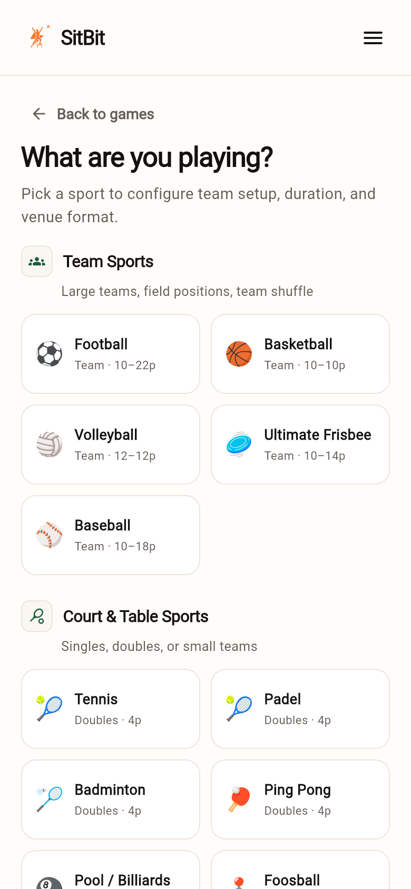
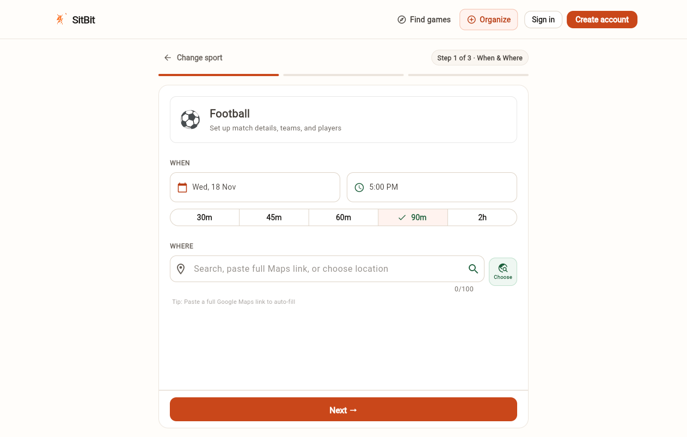
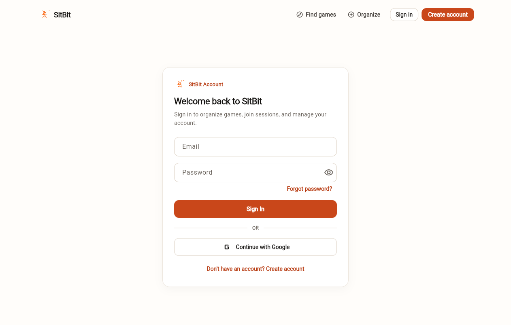
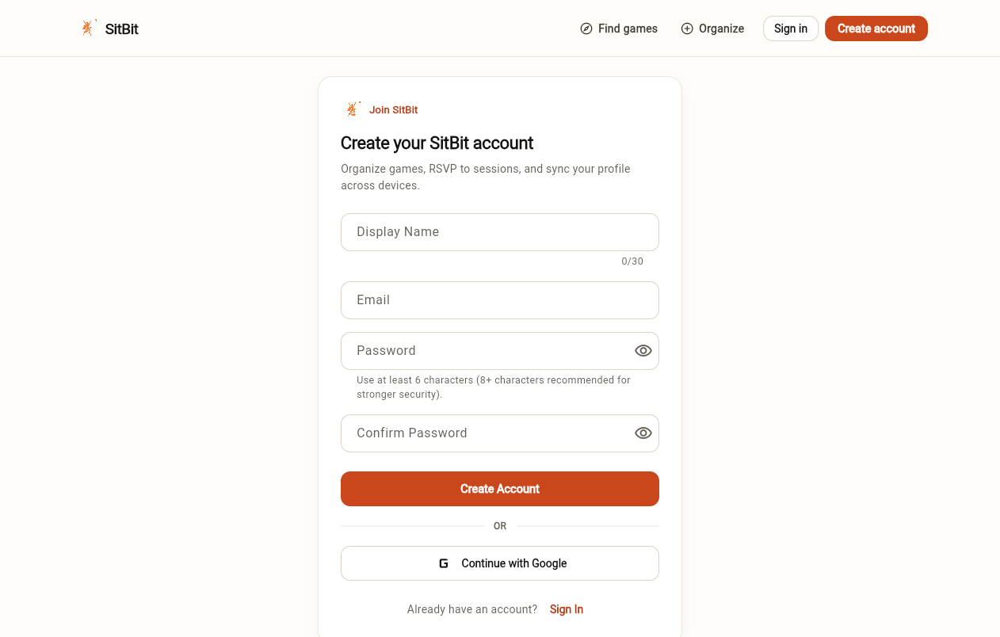

# SitBit Editorial Redesign — Screenshot Review

This directory contains local UI captures for the SitBit warm, light editorial redesign across the marketing site (`sitbit.co`) and the companion web app (`app.sitbit.co`).

> **Review Notes**
> - **Local redesign preview only; not deployed.**
> - **Photography boxes are intentional placeholders** (`assets/photos/hero-community-match.jpg` and `assets/photos/story-after-work-play.jpg`), awaiting owner-supplied imagery.
> - **App screenshots predate the accessibility-only navigation correction** on `_DesktopNavLink` (`MergeSemantics` + inner `ExcludeSemantics`).
> - **Preview build configuration:** The local preview app bundle omitted the production App Check site-key define (`RECAPTCHA_SITE_KEY`) and **must not be deployed**.
> - **Source changes remain local** and are not included in this review branch.

---

## Marketing website

### Desktop (`1280px`, full page)

### Mobile (`390px`, full page)

---

## Games hub

### Desktop (`1280×900`)

### Mobile (`390×844`)

---

## Sport selection

### Desktop (`1280×900`)

### Mobile (`390×844`)

---

## Create game

### Desktop (`1280×900`, Step 1)

---

## Authentication

### Sign in — Desktop (`1280×900`)

### Create account — Desktop (`1280×900`)

